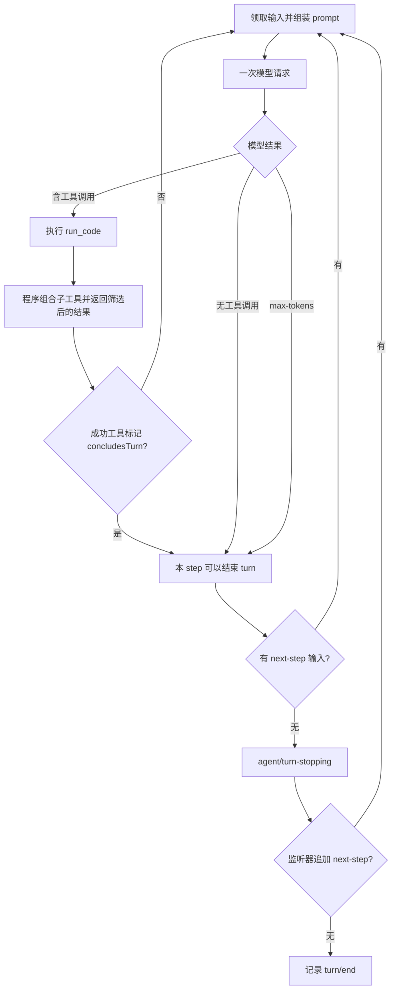

# DeepSeek Harness code 模式设计分析

分析日期：2026-09-22。源码：`/Users/leitao/Code/deepseek-harness`，HEAD：`ddefc45fbc7f8e46dd73185e68295696d1297887`。本文依据本地配置、实现和测试源码，未运行模型或测试；测试引用表示仓库已有的行为断言，不表示本次执行通过。文中的文件链接定位到本机源码，标签给出实际行号范围；源码变更后应按上述 commit 复查。

## 1. 核心结论与术语

这里将 **code 模式**理解为“模型编写程序来调用工具”的模式，当前实现名称为 **PTC（Programmatic Tool Calling）**。它是工具的呈现与调用方式，不是一个独立的编码 agent loop，也不是 plan/执行模式的同义词。旧名称 `tools-code-mode` 到 `tools-ptc` 的迁移可见 [migration.ts:169–172](/Users/leitao/Code/deepseek-harness/packages/session/session-format-v2-to-v3/src/migration.ts:169)；当前 `ptc` preset 明确把自己定义为使用 PTC 呈现的 standard coding agent，见 [agent.cordis.yml:1–17](/Users/leitao/Code/deepseek-harness/packages/preset/agent-presets/presets/ptc/agent.cordis.yml:1)。

设计可以分成四层：

| 层次 | 职责 | 直接证据 |
|---|---|---|
| Agent preset | 选择工具、persona、规划和上下文插件，并声明 `mode: ptc` | [preset:277–280](/Users/leitao/Code/deepseek-harness/packages/preset/agent-presets/presets/ptc/agent.cordis.yml:277) |
| ToolRuntime | 把原生工具映射为 SDK，只向模型暴露 `run_code`，执行子调用并应用工具策略 | [tools/index.ts:988–1008](/Users/leitao/Code/deepseek-harness/packages/core/tools/src/index.ts:988)、[ptc.ts:604–647](/Users/leitao/Code/deepseek-harness/packages/core/tools/src/ptc.ts:604) |
| PtcRuntime | 执行异步程序、提供 bindings、返回输出和错误；Node provider 负责进程和资源限制 | [ptc-runtime/README.md:28–45](/Users/leitao/Code/deepseek-harness/packages/ptc-runtime/ptc-runtime/README.md:28)、[Node runtime:51–68](/Users/leitao/Code/deepseek-harness/packages/ptc-runtime/ptc-runtime-node/src/index.ts:51) |
| ReactLoopAgent | 通用的模型请求、工具执行、下一步和 turn 终止逻辑 | [agent.ts:353–493](/Users/leitao/Code/deepseek-harness/packages/core/agent-loop/src/agent.ts:353) |

最重要的区别是：**程序返回 ≠ turn 结束 ≠ 用户目标完成**。程序返回通常只是产生一条工具结果，loop 还会再请求模型。只有没有普通工具续跑义务、没有 next-step 输入、停止扩展也没有追加工作时，正常 turn 才会关闭；目标是否完成还涉及模型判断或 goal 插件状态。

## 2. 工具如何设计

### 2.1 三种呈现方式，同一份能力注册表

| 模式 | 模型收到的原生 tool schemas | 系统 prompt 中的 SDK | 原生工具能否直接调用 |
|---|---|---|---|
| `native` | 当前 scope 可见的原生工具 | 无 PTC SDK | 可以 |
| `ptc` | 只有 `run_code` | 包含可见工具的参数和返回类型 | 不可以，只能从程序内调用 |
| `both` | 原生工具及 `run_code` | 有 | 可以 |

实现证据：[配置类型与说明:652–675](/Users/leitao/Code/deepseek-harness/packages/core/tools/src/index.ts:652)、[wireSchemas:988–1008](/Users/leitao/Code/deepseek-harness/packages/core/tools/src/index.ts:988)。仓库测试直接断言 PTC 模式的 schema 列表等于 `[run_code]`，同时 SDK 声明包含其他工具，见 [ptc.spec.ts:158–175](/Users/leitao/Code/deepseek-harness/packages/core/tools/tests/ptc.spec.ts:158)。

工具注册表留在 host，preset 用 `ctx.tools.presentAs()` 为自己的 scope 选择呈现方式。因此同一进程可以同时服务 native 与 PTC agent；不是修改一个全局模式开关来影响所有会话。PTC preset 挂载时等待 runtime，缺少依赖时不会等到第一次模型调用才暴露问题。证据：[agent-tool-presentation/index.ts:1–17、59–71](/Users/leitao/Code/deepseek-harness/packages/core/agent-tool-presentation/src/index.ts:1)。

### 2.2 不只是 schema 隐藏，执行器也强制限制

模型如果在 PTC 模式直接发出 `bash` 等原生调用，执行器会识别为“工具存在但当前呈现方式不允许直接调用”，在进入可扩展策略流水线之前返回错误，并告诉模型应从 `run_code` 内调用。程序发起的子调用带有父执行 token，允许到达底层工具。证据：[index.ts:1370–1387](/Users/leitao/Code/deepseek-harness/packages/core/tools/src/index.ts:1370)、[index.ts:1430–1450](/Users/leitao/Code/deepseek-harness/packages/core/tools/src/index.ts:1430)。

这保证 prompt、wire schema 和执行行为一致，而不是依赖模型自觉遵守“请用代码调用”。`run_code` 本身从程序 bindings 中排除，所以没有 `tools.run_code()` 递归入口，见 [ptc.ts:677–684](/Users/leitao/Code/deepseek-harness/packages/core/tools/src/ptc.ts:677)。

### 2.3 `run_code` 的输入输出

必填输入为 `code` 和 `description`。`code` 是异步 TypeScript 函数体，支持顶层 `await`、`return`；`description` 是 UI 展示的简短动作说明，执行时还检查不能全为空白。根据 runtime 能力，schema 还会提供 `timeoutMs`、`sandbox_permissions`、`justification`。证据：[ptc.ts:46–54、96–119](/Users/leitao/Code/deepseek-harness/packages/core/tools/src/ptc.ts:46)、[ptc.ts:328–382](/Users/leitao/Code/deepseek-harness/packages/core/tools/src/ptc.ts:328)。

以下是基于源码内置 bash 示例改写的说明性调用，不是本次真实执行记录：

```json
{
  "name": "run_code",
  "arguments": {
    "code": "const result = await tools.bash({ command: 'pwd', description: 'Show current directory' }); return result;",
    "description": "Show current working directory"
  }
}
```

内置示例会先检查当前 bash schema 是否接受示例参数，避免 prompt 给出不存在或不兼容的调用方式，见 [ts-types.ts:270–282](/Users/leitao/Code/deepseek-harness/packages/core/tools/src/ts-types.ts:270)。

子工具向程序返回 canonical JSON value，而不是让程序解析面向模型的文本。程序只把 `return` 或日志选出的结果暴露给模型。外层结构是 `{ logs, result?, sandbox? }`，渲染时合并日志与返回值；无输出时明确返回 `(run_code completed with no output)`。证据：[ptc.ts:287–288](/Users/leitao/Code/deepseek-harness/packages/core/tools/src/ptc.ts:287)、[ptc.ts:346–369](/Users/leitao/Code/deepseek-harness/packages/core/tools/src/ptc.ts:346)、[ptc.ts:659–669](/Users/leitao/Code/deepseek-harness/packages/core/tools/src/ptc.ts:659)。

### 2.4 工具集来自组合，不是 PTC 固定内置

随附 `ptc` preset 组合了按平台选择的 Bash/PowerShell、文件读写与搜索、jobs、skills、goal、plan、compaction、subagent、ask-user、todo、web 和文件交付等能力。具体行见 [preset:52–106](/Users/leitao/Code/deepseek-harness/packages/preset/agent-presets/presets/ptc/agent.cordis.yml:52)、[preset:112–163](/Users/leitao/Code/deepseek-harness/packages/preset/agent-presets/presets/ptc/agent.cordis.yml:112)、[preset:182–205](/Users/leitao/Code/deepseek-harness/packages/preset/agent-presets/presets/ptc/agent.cordis.yml:182)、[preset:256–283](/Users/leitao/Code/deepseek-harness/packages/preset/agent-presets/presets/ptc/agent.cordis.yml:256)。

通用 `workflow` 工具和 `workflow-ptc` 在该 preset 中禁用，`ralph` 也默认禁用；这里把 `run_code` 作为模型编写编排程序的入口。不要把 base bundle 中存在某插件误写为每个 PTC 会话都暴露它。证据：[preset:229–249](/Users/leitao/Code/deepseek-harness/packages/preset/agent-presets/presets/ptc/agent.cordis.yml:229)。

### 2.5 并发、错误和日志

`Promise.all` 只表示程序提交并发意图。宿主仍根据每个工具的并发分类调度：安全调用可重叠，exclusive 调用等待其他调用排空并独占执行；默认子调用重叠上限为 10。pre-execute 和结果提交保持顺序，exclusive 屏障覆盖 post-execute。证据：[index.ts:668–675](/Users/leitao/Code/deepseek-harness/packages/core/tools/src/index.ts:668)、[ptc.ts:460–505](/Users/leitao/Code/deepseek-harness/packages/core/tools/src/ptc.ts:460)、[ptc.ts:604–653](/Users/leitao/Code/deepseek-harness/packages/core/tools/src/ptc.ts:604)。

失败子调用向程序抛出 `ToolCallError`，模型可以写 `try/catch` 恢复。程序整体失败则转换成外层 `CODE_RUN_FAILED` 工具错误，保留失败种类和已捕获日志，让下一次模型请求可以修正代码。证据：[SDK 指令:254–259](/Users/leitao/Code/deepseek-harness/packages/core/tools/src/ts-types.ts:254)、[错误类型:160–171](/Users/leitao/Code/deepseek-harness/packages/core/tools/src/ptc.ts:160)、[结果转换:710–719](/Users/leitao/Code/deepseek-harness/packages/core/tools/src/ptc.ts:710)。

每个开始执行的子调用记录 `tool/ptc-dispatch-start`，结算记录 `tool/ptc-dispatch`，带 `rootCallId`、`parentCallId`、`subCallId`、参数和结果。普通中间结果不自动加入模型历史，但审计日志仍可检查；图片结果和额外上下文会通过 `deferContext` 进入后续请求。证据：[ptc.ts:536–547、568–591](/Users/leitao/Code/deepseek-harness/packages/core/tools/src/ptc.ts:536)、[ptc.ts:604–647](/Users/leitao/Code/deepseek-harness/packages/core/tools/src/ptc.ts:604)。测试同时断言“外层只输出筛选后的内容”和“两条子调用都留有日志”，见 [ptc.spec.ts:925–950](/Users/leitao/Code/deepseek-harness/packages/core/tools/tests/ptc.spec.ts:925)。

## 3. Prompt 如何设计

### 3.1 分段组合，并把调用规则放在工具指导之前

PTC 没有一份包办全部行为的大 prompt。persona、工具指导、SDK 和其他策略由插件贡献。默认排序中的关键值为：persona prefix `0`、plan policy `500`、PTC-only `800`、工具指导 `1000` 起、SDK `5000`。因此模型先知道“只能直接调用 run_code”，再读到“使用 bash/read 等工具”的指导。证据：[system-prompt/index.ts:125–159](/Users/leitao/Code/deepseek-harness/packages/core/system-prompt/src/index.ts:125)。

PTC-only 的实际文字为：

> `run_code` is the only tool you can call directly — a tool call naming any other tool fails. Reach every tool the SDK declares below from inside the program.

来源：[tools/index.ts:52](/Users/leitao/Code/deepseek-harness/packages/core/tools/src/index.ts:52)。该段仅在有效模式为 `ptc` 时出现，`both` 不会错误地禁止原生调用，见 [collapseSection:856–863](/Users/leitao/Code/deepseek-harness/packages/core/tools/src/index.ts:856)。排序由测试断言固定，见 [ptc.spec.ts:178–195](/Users/leitao/Code/deepseek-harness/packages/core/tools/tests/ptc.spec.ts:178)。

### 3.2 SDK 同时告诉模型“怎么调用”和“会返回什么”

SDK 指令约定：只能使用可擦除 TypeScript 语法，不支持 enum/namespace；类型标注是辅助说明，运行时只剥离类型。工具参数必须是无损 JSON；失败用 `ToolCallError` 捕获；独立只读操作可用 `Promise.all`，依赖操作用 `await`；只输出需要送回模型的结果。证据：[ts-types.ts:249–261](/Users/leitao/Code/deepseek-harness/packages/core/tools/src/ts-types.ts:249)。

生成器从工具 schema 生成 `ToolArgsMap`、`ToolOutputMap`，最终得到以下映射式接口：

```ts
declare const tools: {
  [K in ToolName]: (args: ToolArgsMap[K]) => Promise<ToolOutputMap[K]>;
};
```

工具按名称排序；相同工具集得到稳定文本。SDK 按当前调用 scope 的可见工具重新生成，并设置 `interpolate: false`。证据：[ts-types.ts:297–316](/Users/leitao/Code/deepseek-harness/packages/core/tools/src/ts-types.ts:297)、[tools/index.ts:876–892](/Users/leitao/Code/deepseek-harness/packages/core/tools/src/index.ts:876)。

这使模型能在一次程序中读取结构化字段、过滤和聚合，而不用每次让 LLM 消费完整工具文本后再决定下一调用。这里是从返回类型与输出策略推导出的设计收益，并非本次测得的 token 或延迟下降比例。

### 3.3 Persona、仓库指导和 plan 模式是独立贡献

PTC preset 的 persona 是 `You are a coding agent powered by the {{model}} model.`，并补充工作目录；它同时启用 `agent-instructions`，字节预算为 65536。证据：[preset:29–41](/Users/leitao/Code/deepseek-harness/packages/preset/agent-presets/presets/ptc/agent.cordis.yml:29)。仓库指导插件根据 session cwd 查找项目根、加载 baseline instruction set，并维护上下文状态；不能把这部分简单理解为把所有文件一直拼进静态 system prompt，见 [agent-instructions/index.ts:108–155](/Users/leitao/Code/deepseek-harness/packages/context/agent-instructions/src/index.ts:108)。

plan 模式的指导也存在于 PTC preset：要求只做探索，完整计划交给 `exit_plan_mode`；说明为缓存稳定而保留工具目录，不能因写工具仍在目录中就认为允许使用。由此可见 **PTC 选择调用形式，plan mode 选择行为政策**。证据：[preset:118–132](/Users/leitao/Code/deepseek-harness/packages/preset/agent-presets/presets/ptc/agent.cordis.yml:118)。这里只据配置说明 prompt 规则，不据此推断所有限制都由执行器强制。

### 3.4 Prompt 与请求历史可追溯

每个 proposed step 先 assemble prompt，再经过 `agent/pre-step`；进入请求时把 system prompt 的投影变化写为 `system/message`，把接受的输入写为 `user/message`，然后构建请求。证据：[agent.ts:241–259](/Users/leitao/Code/deepseek-harness/packages/core/agent-loop/src/agent.ts:241)、[agent.ts:359–380](/Users/leitao/Code/deepseek-harness/packages/core/agent-loop/src/agent.ts:359)。因此 PTC SDK 和指导属于可还原的模型输入，而不是执行时不可见的旁路知识。

## 4. 代码运行时及程序结束条件

随附 base bundle 挂载 `dsh-ptc-runtime-node`，见 [base/cordis.patch.yml:376–377](/Users/leitao/Code/deepseek-harness/packages/bundle/base/cordis.patch.yml:376)。其语言为 TypeScript、隔离方式为 process；每次调用新建 Node 进程，允许 `await import(...)` 使用 Node API，程序环境从空 `process.env` 开始，路径使用 session 工作目录，直接文件访问服从本次 sandbox policy。证据：[Node runtime:51–68](/Users/leitao/Code/deepseek-harness/packages/ptc-runtime/ptc-runtime-node/src/index.ts:51)、[ptc.ts:690–700](/Users/leitao/Code/deepseek-harness/packages/core/tools/src/ptc.ts:690)。

TypeScript 先通过 `stripTypeScriptTypes` 擦除类型，bootstrap 再用严格模式的 `AsyncFunction` 执行函数体。`await fn(...)` 完成后发送 `done`；throw 则发送包含异常的 `done`。这不是跨调用保留变量的 REPL。证据：[Node runtime:206–209](/Users/leitao/Code/deepseek-harness/packages/ptc-runtime/ptc-runtime-node/src/index.ts:206)、[bootstrap.ts:398–421](/Users/leitao/Code/deepseek-harness/packages/ptc-runtime/ptc-runtime-node/src/bootstrap.ts:398)。

| 程序级条件 | 结果与作用范围 | 证据 |
|---|---|---|
| `return` 或函数体自然完成 | 得到 completion value，结束本次程序 | [bootstrap.ts:410–421](/Users/leitao/Code/deepseek-harness/packages/ptc-runtime/ptc-runtime-node/src/bootstrap.ts:410) |
| 未捕获异常 | 形成程序失败，最终成为外层工具错误 | [bootstrap.ts:415–418](/Users/leitao/Code/deepseek-harness/packages/ptc-runtime/ptc-runtime-node/src/bootstrap.ts:415)、[ptc.ts:710–714](/Users/leitao/Code/deepseek-harness/packages/core/tools/src/ptc.ts:710) |
| 墙钟超时 | 宿主 abort 并清理进程；不是限制代码循环次数 | [Node runtime:163–198](/Users/leitao/Code/deepseek-harness/packages/ptc-runtime/ptc-runtime-node/src/index.ts:163) |
| 外层取消 | 传入取消信号；run_code 子调用也收到取消 | [ptc.ts:401–407](/Users/leitao/Code/deepseek-harness/packages/core/tools/src/ptc.ts:401) |
| 输出超限 | `output-limit` 失败 | [Node runtime:241–246](/Users/leitao/Code/deepseek-harness/packages/ptc-runtime/ptc-runtime-node/src/index.ts:241) |
| 任意结算 | 中止未结束的子调用，排空执行与日志，再返回 | [ptc.ts:702–707](/Users/leitao/Code/deepseek-harness/packages/core/tools/src/ptc.ts:702)、[ptc.ts:515–523](/Users/leitao/Code/deepseek-harness/packages/core/tools/src/ptc.ts:515) |

Node 默认 deadline 为 **120000 ms**，最大 **600000 ms**；输出预算 **64 MiB**，V8 old-generation 上限 **512 MiB**，控制消息预算 **128 MiB**，pending host bindings 上限 **128**，清理 grace **3000 ms**。这些是可配置默认值，不等于部署必然使用的值；V8 限制也不等于整个进程的总内存上限。证据：[Node runtime:25–64](/Users/leitao/Code/deepseek-harness/packages/ptc-runtime/ptc-runtime-node/src/index.ts:25)。

模型侧 `timeoutMs` 必须是正数，不能用 0 禁用 deadline；其描述包含嵌套工具和审批等待。底层 runtime 服务另接受 `null` deadline，但这不是模型 `run_code` 的公开输入语义。证据：[ptc.ts:111–114、378–382](/Users/leitao/Code/deepseek-harness/packages/core/tools/src/ptc.ts:111)、[Node runtime:108–117](/Users/leitao/Code/deepseek-harness/packages/ptc-runtime/ptc-runtime-node/src/index.ts:108)。程序 sandbox 升权只授权本次完整程序，子工具仍保留各自政策和审批；失败后的已完成副作用不会自动回滚，也不会自动重放程序，见 [ptc.ts:122–124](/Users/leitao/Code/deepseek-harness/packages/core/tools/src/ptc.ts:122)。

呈现层也支持 Python SDK，仓库有私有实验性 CPython provider；不要把它写成随附 Node provider 自动支持执行 Python，或假定两种 provider 有相同文件隔离能力。证据：[SDK renderer 表:54–57](/Users/leitao/Code/deepseek-harness/packages/core/tools/src/index.ts:54)、[runtime 后端说明:43–45](/Users/leitao/Code/deepseek-harness/packages/ptc-runtime/ptc-runtime/README.md:43)。

## 5. Agent loop 的结束条件

### 5.1 Step、turn 和程序不是同一层循环



该图表示正常结算路径；取消、pre-step 拒绝和未恢复错误分别走下面的终止分支。`run_code` 内可有很多子工具调用，但只要没有再请求模型，就没有产生额外 model step。依据是 `step()` 把一次模型响应中的工具批次执行完后才返回，见 [agent.ts:485–493](/Users/leitao/Code/deepseek-harness/packages/core/agent-loop/src/agent.ts:485)。

### 5.2 可逐项核对的终止规则

| 条件 | 实际行为 | 源码 |
|---|---|---|
| 模型消息没有 `tool-call` block | step 返回 `completed`，进入 turn 停止判断；空回复也不要求某个“完成”关键词 | [agent.ts:487–488](/Users/leitao/Code/deepseek-harness/packages/core/agent-loop/src/agent.ts:487) |
| 有普通工具调用，未标记结束 | 执行后返回 `null`，表示仍欠下一次模型请求；工具成功和普通工具错误都不会自动等价于 turn 结束 | [agent.ts:489–493](/Users/leitao/Code/deepseek-harness/packages/core/agent-loop/src/agent.ts:489) |
| 工具成功结果带 `concludesTurn` | step 返回 `completed`，免除普通工具结果所要求的续请求 | [tool-calls.ts:147–158](/Users/leitao/Code/deepseek-harness/packages/core/agent-loop/src/tool-calls.ts:147)、[agent.ts:493](/Users/leitao/Code/deepseek-harness/packages/core/agent-loop/src/agent.ts:493) |
| step 可结束，但已有 next-step 输入 | 继续处理输入，不立即关闭 turn | [agent.ts:315–321](/Users/leitao/Code/deepseek-harness/packages/core/agent-loop/src/agent.ts:315) |
| step 可结束，且无 next-step 输入 | 调用 serial `agent/turn-stopping`；监听器仍可追加下一步 | [agent.ts:316–320](/Users/leitao/Code/deepseek-harness/packages/core/agent-loop/src/agent.ts:316) |
| provider finish 为 `max-tokens` | step 返回该原因，不执行本次响应的工具调用；原因在后续正常 step 后仍保留 | [agent.ts:485](/Users/leitao/Code/deepseek-harness/packages/core/agent-loop/src/agent.ts:485)、[agent.ts:306–311](/Users/leitao/Code/deepseek-harness/packages/core/agent-loop/src/agent.ts:306) |
| `agent/pre-step` 返回 reject | turn 以 `blocked` 结束，当前 driver 停止 | [agent.ts:290–294](/Users/leitao/Code/deepseek-harness/packages/core/agent-loop/src/agent.ts:290) |
| 初次 step 输入被改为空 | 不请求模型，关闭一个 `completed` turn | [agent.ts:295–300](/Users/leitao/Code/deepseek-harness/packages/core/agent-loop/src/agent.ts:295) |
| 外部取消 | turn 记为 `aborted`，保留取消原因 | [agent.ts:323–326](/Users/leitao/Code/deepseek-harness/packages/core/agent-loop/src/agent.ts:323) |
| 未恢复错误 | turn 记为 `error`；模型请求错误可经 `agent/request-error` 插件选择 retry | [agent.ts:328–340](/Users/leitao/Code/deepseek-harness/packages/core/agent-loop/src/agent.ts:328)、[agent.ts:443–464](/Users/leitao/Code/deepseek-harness/packages/core/agent-loop/src/agent.ts:443) |

PTC 会把成功子工具的 `concludesTurn` 转发给外层 `run_code`，因此封装后不会丢失工具的终止语义；被策略转换为失败的子工具结果不能借恢复程序保留该标志。证据：[ptc.ts:641–646](/Users/leitao/Code/deepseek-harness/packages/core/tools/src/ptc.ts:641)、[ptc.spec.ts:983–1020](/Users/leitao/Code/deepseek-harness/packages/core/tools/tests/ptc.spec.ts:983)。

`concludesTurn` 也不是立即杀死执行或忽略所有新输入：工具批次继续按调度器结算，loop 汇总该标志；已有 steering 仍可让 turn 继续。证据：[tool-calls.ts:83–101](/Users/leitao/Code/deepseek-harness/packages/core/agent-loop/src/tool-calls.ts:83)、[loop.spec.ts:1130–1155](/Users/leitao/Code/deepseek-harness/packages/core/agent-loop/tests/loop.spec.ts:1130)。

关闭 turn 后，driver 检查 inbox：没有 pending 则停止，有 pending 则重置 abort controller 和 step 计数，开启下一个 turn。外层 `kick()` 循环退出后才转为 idle。证据：[agent.ts:337–350](/Users/leitao/Code/deepseek-harness/packages/core/agent-loop/src/agent.ts:337)、[agent.ts:226–237](/Users/leitao/Code/deepseek-harness/packages/core/agent-loop/src/agent.ts:226)。

### 5.3 没有通用的“任务已完成验证器”

在上述通用 loop 中，`completed` 表示本轮交互的完成状态，判据来自模型是否继续调用工具、工具结束标志和队列，而不是自动检查测试是否通过、文件是否正确、TODO 是否全部完成。它也没有在这段正常循环中按固定最大 step 数终止；运行时 deadline 和 goal round limit 分别约束其他层次。此结论是对 [turn 实现:269–350](/Users/leitao/Code/deepseek-harness/packages/core/agent-loop/src/agent.ts:269) 与 [step 结算:443–493](/Users/leitao/Code/deepseek-harness/packages/core/agent-loop/src/agent.ts:443) 的限定性解读，不排除部署额外挂载停止策略插件。

## 6. 重复调用提醒与 goal 自动续跑

### 6.1 重复调用提醒是软约束

base bundle 配置重复阈值 `[3, 5, 8]`，见 [base:440–445](/Users/leitao/Code/deepseek-harness/packages/bundle/base/cordis.patch.yml:440)。插件按工具名和 canonical 参数累计连续重复，在阈值处生成提醒，通过 `additionalContexts` 附加到结果，不自行拒绝调用或取消 agent。用户新输入会重置统计。证据：[repeat-tool-reminder/index.ts:189–232](/Users/leitao/Code/deepseek-harness/packages/guard/repeat-tool-reminder/src/index.ts:189)。

因此它能提示模型改变方法，但不是确定性的死循环硬停止器；不能据此承诺第 8 次重复必定退出。

### 6.2 Goal driver 在 turn 之外决定是否继续

base 挂载 goal service 和 goal-round-driver，PTC preset 也提供 goal 工具。driver 等 agent 为 idle、无竞争输入时检查 goal；只有 `phase === 'active'` 且 `activation === 'armed'` 才发起下一轮。它通过 `agent.followup(message)` 把带 goal id、revision、round 的续跑消息重新放进同一会话，而不是让 `run_code` 自己永不返回。证据：[base:299–303](/Users/leitao/Code/deepseek-harness/packages/bundle/base/cordis.patch.yml:299)、[goal driver:102–109、164–192](/Users/leitao/Code/deepseek-harness/packages/goal/goal-round-driver/src/index.ts:102)。

达到 `maxGoalRounds` 会把 goal 标为 `blocked`，原因是 `round-limit`。这里限制的是 goal continuation rounds，不是每轮内部的工具数或 model steps。证据：[goal driver:164–175](/Users/leitao/Code/deepseek-harness/packages/goal/goal-round-driver/src/index.ts:164)。

自动续跑期间，模型通过 `update_goal` 标 complete/blocked 后，工具会注入收尾上下文，要求下一次回复说明结果或阻塞点，不再调用工具。该路径本身不是立即 `concludeTurn()`；它保留一次写给用户的收尾机会。证据：[tool-goal/index.ts:314–333](/Users/leitao/Code/deepseek-harness/packages/goal/tool-goal/src/index.ts:314)、[wrapup.ts:17–39](/Users/leitao/Code/deepseek-harness/packages/goal/tool-goal/src/wrapup.ts:17)。其中“不再调用工具”在这些代码中表现为 prompt 指令，不应误写为独立执行器封锁。

对 blocked 的约束也应区分软硬：代码检查自动 goal round 的最小轮数，具体“是否同一阻塞持续存在”仍由模型判断并填写说明。证据：[tool-goal/index.ts:236–238](/Users/leitao/Code/deepseek-harness/packages/goal/tool-goal/src/index.ts:236)、[tool-goal/index.ts:306–311](/Users/leitao/Code/deepseek-harness/packages/goal/tool-goal/src/index.ts:306)。

## 7. 对设计收益与代价的判断

以下是依据前述实现的分析，不是性能实测：

| 设计 | 收益 | 代价或限制 |
|---|---|---|
| 程序内编排多个工具 | 可减少需要模型参与的往返，让依赖、过滤、聚合由程序完成 | 模型必须写出可运行代码；需要处理语法、异常和输出选择 |
| typed SDK 与 canonical JSON 返回 | 工具数据可直接参与计算，减少文本解析 | SDK 声明仍占 prompt；只有一个原生 schema 不代表描述成本归零 |
| 筛选输出与完整子调用日志分开 | 控制模型上下文，同时保留审计证据 | 程序未打印/返回的重要细节可能不会被下一步模型看到 |
| 统一子调用策略与并发调度 | 封装不会绕开工具权限、错误处理和独占要求 | `Promise.all` 不保证所有调用都物理并行 |
| 新进程、deadline、输出与消息预算 | 单次代码执行可清理、可限额，变量不跨调用污染 | 单次程序预算不能保证整个 agent/goal 最终停止 |
| 通用 loop 加 goal driver | 程序执行、交互轮次、长期目标的生命周期可分别扩展 | 必须显式区分“程序成功”“turn completed”“goal complete”的产品语义 |

如果要借鉴到 langharness，优先保留这些分工：工具规格同时声明参数与结构化返回；从同一工具注册表生成 SDK；程序调用继续经过原工具策略；将程序输出和审计事件分开；明确 run、step、turn、goal 四层结束条件。尤其不要只新增一个 `execute_code` 工具和一段 prompt，却遗漏执行层的直调限制、子调用取消与排空、结果筛选及终止标志传播。

## 8. 已有测试证据与复查入口

本次只阅读以下测试证据，没有执行测试或调用真实模型：

| 行为 | 测试位置 |
|---|---|
| PTC 仅暴露 run_code，SDK 不递归暴露 run_code | [ptc.spec.ts:166–175](/Users/leitao/Code/deepseek-harness/packages/core/tools/tests/ptc.spec.ts:166) |
| PTC-only 指令先于工具指导与 SDK | [ptc.spec.ts:178–195](/Users/leitao/Code/deepseek-harness/packages/core/tools/tests/ptc.spec.ts:178) |
| 外层结果筛选且逐个记录子调用 | [ptc.spec.ts:925–950](/Users/leitao/Code/deepseek-harness/packages/core/tools/tests/ptc.spec.ts:925) |
| 子工具结束标志转发，以及策略否决后的标志清除 | [ptc.spec.ts:983–1020](/Users/leitao/Code/deepseek-harness/packages/core/tools/tests/ptc.spec.ts:983) |
| turn-stopping 可追加后续 step | [loop.spec.ts:1085–1105](/Users/leitao/Code/deepseek-harness/packages/core/agent-loop/tests/loop.spec.ts:1085) |
| concludesTurn 省去下一次模型请求，但不吞掉 steering | [loop.spec.ts:1108–1155](/Users/leitao/Code/deepseek-harness/packages/core/agent-loop/tests/loop.spec.ts:1108) |

源码复查时建议依次阅读：PTC preset → `tools/index.ts` 的 `wireSchemas`/SDK section → `ts-types.ts` 的 SDK 指令 → `ptc.ts` 的 bridge → Node runtime → `agent.ts` 的 `turn()`/`step()` → goal driver。这个顺序可以把“模型获知什么、实际允许什么、什么时候停”逐一对应起来。
