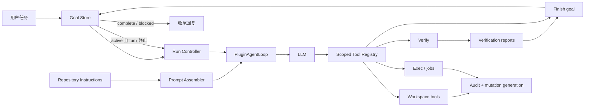
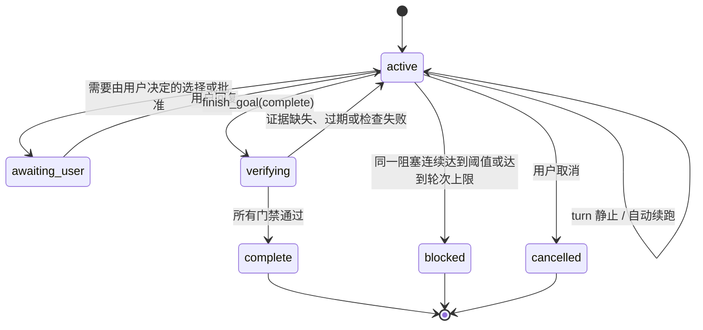

# Code Agent 设计方案

## 1. 目标与结论

本文设计一个可在 langharness 中按 agent 独立装配的 coding agent。它应能读取
仓库、修改文件、运行验证、处理长任务，并用可审计证据判断目标是否完成。

设计参考
[DeepSeek Harness code 模式分析](../deepseek-harness-code-mode-analysis.md)，并复核了
本地 `/Users/leitao/Code/deepseek-harness` 的 PTC preset、工具 SDK、agent loop 和
goal driver 源码（HEAD `ddefc45fbc7f8e46dd73185e68295696d1297887`）。

核心决策如下：

1. **Code agent 是一个 agent preset，不是一件工具。** 它由 prompt、工具、权限、
   goal controller、checkpointer 和模型共同构成。
2. **首版使用原生 tool calling。** 当前 langharness 已具备 LangChain
   `create_agent`、scoped `ToolProvider` 和流式事件，先补齐 coding 工具、仓库指令与
   goal 闭环即可交付可靠版本。
3. **PTC 是第二阶段的工具呈现方式。** 最终支持 `native | ptc | both`，但 PTC 必须
   同时实现 typed SDK、直调阻断、子调用策略、取消、日志和资源限制；不接受只加
   `execute_code` 工具和一段说明文字的“伪 PTC”。
4. **模型停止输出不等于目标完成。** 只有 goal completion 工具提交证据且宿主验证
   通过，目标才能进入 `complete`。普通无工具回复只表示本轮 turn 静止。
5. **生产工具不再直接使用当前 `ShellTool` 作为安全边界。** 现有
   `workspace.py` 的文件工具受 `root_dir` 约束，但 `ShellTool` 直接在服务进程环境中
   执行命令；它适合现状实验，不足以承诺 workspace 隔离、超时、后台任务和审计。

## 2. 范围

首版应支持：

- 理解用户的代码任务并维护显式 goal；
- 自动读取从 workspace 根到目标文件路径上的仓库指令；
- 搜索、读取、补丁式编辑文件；
- 运行命令、测试、lint/type check，并保留结构化执行证据；
- 对危险操作请求批准，对纯读取并发执行；
- 跨多个 model turn 自动继续，直到完成、阻塞、取消或达到预算；
- 在结束消息中报告改动、验证证据和剩余风险。

首版不包含：

- 任意容器/VM 级强隔离；
- 自动提交、推送、创建 PR；
- 默认联网或自动安装依赖；
- 多 agent delegation；
- PTC 程序执行器。PTC 在第二阶段单独验收。

## 3. 现状与缺口

当前可复用能力：

- `PluginAgentLoop` 已按 agent scope 聚合 LLM、tools、middleware、system prompt、
  checkpointer 等服务，并在服务变化时重建 LangChain graph；
- `AgentDirectoryPlugin` 已按 agent 创建独立插件实例，以 `plugin.agent_id` 和
  `requires.filters` 隔离；
- `WorkspaceToolsPlugin` 已提供基础文件工具和 Bash；
- SQLite checkpointer、流式 tool events、human approval middleware 已存在；
- `SystemPromptProvider` 已能组合多个 prompt provider。

必须补齐的缺口：

- system prompt 目前只是无元数据的字符串拼接，没有稳定 section 顺序、来源、预算和
  动态仓库指令；
- 默认 agent 只装配 `tools` 和 `name`，没有 code-agent preset；
- 文件修改以整文件写入为主，没有补丁、变更代次和编辑审计；
- Bash 没有可靠的 cwd 边界、deadline、输出上限、后台任务和进程清理语义；
- `create_agent` 的“模型不再调用工具”只结束一次 graph run，没有 goal 状态机或
  验证门禁；
- 没有“最近一次修改之后验证是否仍然有效”的证据模型。

## 4. 总体架构



新增能力仍通过 Pelix service specification 通信，不让插件导入彼此的具体实现。
建议增加四个公共契约：

| Specification | Protocol | 职责 |
|---|---|---|
| `agent.plugin.prompt_section` | `PromptSectionProvider` | 提供有序、具名、带预算的 prompt sections |
| `agent.plugin.goal` | `GoalProvider` | 创建、查询、更新持久化 goal |
| `agent.plugin.run_controller` | `RunControllerProvider` | graph 静止后决定继续、停止或收尾 |
| `agent.plugin.verifier` | `VerificationProvider` | 执行验证策略并签发结构化 report |

这些 Protocol 均放在 `src/langharness_core/contracts.py`，以
`@service_contract(SPEC_*)` 声明；`@Provides`/`@Requires` 使用 Protocol 类。

### 4.1 Code agent preset

新增 preset/package `code.agent`，每个 code agent 实例至少物化：

- code persona prompt；
- operating policy prompt；
- repository-instructions provider；
- completion policy prompt；
- workspace read/search/edit tools；
- command/job tools；
- goal、verify、finish tools；
- human approval middleware；
- SQLite checkpointer；
- goal run controller。

它不是新的全局开关。普通 `simple_agent` 可以继续使用现有插件集，code agent 通过
agent 配置选择 preset，并继承相同的 scoped service 规则。

## 5. Prompt 方案

### 5.1 必须导入的 prompt sections

Prompt 不做成一个不可维护的大字符串。建议按下表组合，`order` 小的先出现：

| 顺序 | Section | 来源 | 内容与理由 |
|---:|---|---|---|
| 0 | `identity` | `prompts/code_agent/identity.md` | “你是 coding agent”、模型名、workspace；只定义角色，不塞工具细节 |
| 100 | `safety` | `prompts/code_agent/safety.md` | workspace 边界、秘密信息、破坏性操作、外部副作用和批准规则 |
| 200 | `workflow` | `prompts/code_agent/workflow.md` | 先检查现状，最小修改，TDD/项目约束优先，修改后验证 |
| 300 | `completion` | `prompts/code_agent/completion.md` | 明确 turn/goal 区别，何时调用 `finish_goal`，禁止仅凭口头声明完成 |
| 500 | `repository-instructions` | 动态 provider | `AGENTS.md` 等项目指令，按 workspace→目标路径逐层覆盖 |
| 700 | `mode-policy` | plan/default mode provider | plan 模式只读；default 模式允许在权限内修改 |
| 800 | `ptc-only` | PTC presenter，第二阶段 | 只有 `run_code` 可直接调用；必须由执行器使用同一判据强制 |
| 1000+ | `tool-guidance:*` | 各 ToolProvider | 工具用途、边界、何时使用；从实际可见工具集合生成 |
| 5000 | `tools-sdk` | PTC presenter，第二阶段 | 从 schema 稳定生成参数与结构化返回类型，不手写维护 |
| 9000 | `goal-round` / `goal-wrapup` | run controller | 自动续跑输入；完成/阻塞后的最后一条用户可读回复规则 |

建议的静态 prompt 要点如下。

`identity.md`：

- 你是工作在指定 workspace 内的 coding agent；
- 以仓库当前内容和工具结果为事实来源；
- 结果应落在用户要求的文件或可验证输出中，而不只是解释如何做。

`workflow.md`：

- 开始时读取适用的 repository instructions 和相关代码；
- 优先使用结构化搜索和补丁编辑，避免无目的遍历；
- 修改前识别受影响调用方和测试；
- 遵守 TDD、格式、类型、测试等仓库本地规则；
- 不覆盖用户已有的无关改动；
- 工具失败后读错误并改变方法，不重复同一失败调用。

`completion.md`：

- 程序返回、工具成功、model turn 结束、goal 完成是四种不同状态；
- 有代码改动时必须产生修改后的新鲜验证报告；
- 只有 `finish_goal(status="complete", evidence=[...])` 成功才算完成；
- 缺少用户决策时请求用户，不能猜测会改变需求的选择；
- 同一阻塞连续达到阈值后才可标 `blocked`，并说明已尝试内容与解除条件；
- 收尾回复列出 outcome、changed files、checks 和已知风险。

`safety.md`：

- 不读取 workspace 外文件，除非用户明确把它加入任务范围；
- 不回显 token、密钥或环境秘密；
- 删除、覆盖大量文件、修改 git history、联网发布等动作必须走审批策略；
- 不用 git reset/checkout 清理用户改动；
- 命令的权限、cwd、deadline 以宿主返回为准，prompt 不能提升权限。

### 5.2 仓库指令导入

新增 `RepositoryInstructionsPlugin`。它以 workspace 为根，查找：

1. workspace 根的 `AGENTS.md`；
2. 从根到当前目标文件目录之间更深层的 `AGENTS.md`；
3. 可配置兼容文件，例如 `CLAUDE.md`，默认不开启以避免规则冲突。

规则：更深层指令只覆盖其目录子树；每段记录真实路径和内容 hash；总字节预算默认
64 KiB；超限时保留根指令与最接近目标文件的指令，并向模型明确报告被省略部分。
不得把整个仓库文件列表或 README 默认塞进 system prompt。

当一轮尚未确定目标文件时只加载根指令；工具首次触及更深目录后，由 prompt provider
在下一 model step 增加对应指令。指令文件变化后按 hash 失效，不要求重启 agent。

### 5.3 Prompt contract

建议的数据结构：

```python
@dataclass(frozen=True)
class PromptSection:
    name: str
    order: int
    text: str
    source: str
    max_bytes: int | None = None

@service_contract(SPEC_PROMPT_SECTION)
class PromptSectionProvider(Protocol):
    def get_prompt_sections(self, context: PromptContext) -> list[PromptSection]: ...
```

assembler 按 `(order, name, source)` 稳定排序；同名 section 在同一 scope chain 中
nearest-scope wins；每次 model request 记录 section 名、hash、字节数，便于重放问题。
现有 `SystemPromptProvider.get_system_prompt()` 在迁移期由 adapter 包成 order=1000 的
legacy section，之后弃用，不能继续依赖 service 绑定的偶然顺序。

## 6. 工具方案

### 6.1 首版必需工具

| 工具 | 最小输入 | 结构化输出 | 策略 |
|---|---|---|---|
| `list_directory` | path, depth/limit | entries, truncated | 只读，可并发，限制根目录与数量 |
| `read_file` | path, offset/limit | text, line range, hash, truncated | 只读，可并发，禁止目录穿越 |
| `search_text` | query/glob/path | matches with file/line, truncated | 只读，可并发；优先 ripgrep 实现 |
| `apply_patch` | patch | changed files, before/after hashes, diagnostics | 写操作，独占；原子应用，失败不部分写 |
| `workspace_status` | 无 | git state, changed/untracked files | 只读；区分 agent 与用户已有改动 |
| `exec_command` | argv/command, cwd, timeout | exit code, stdout/stderr, duration, call id | 有界执行；不直接继承秘密环境 |
| `write_stdin` | job id, input | output delta, state | 控制已存在的长任务 |
| `wait_job` | job id, timeout | output delta, state | 等待不得超过交互更新周期 |
| `stop_job` | job id | final state | 终止 agent 自己拥有的进程 |
| `verify` | profile/selected checks | signed report id, generation, checks | 宿主执行完成门禁 |
| `get_goal` | 无 | objective, status, rounds, evidence | 只读 |
| `finish_goal` | status, summary, evidence ids/blocker | transition or rejection reasons | 唯一目标终结入口 |
| `ask_user` | question | deferred answer | 只用于不可从仓库发现的用户选择 |

所有 tool schema 都必须同时声明输入和 JSON 输出；异常使用统一
`ToolError {code, message, retryable, details}`，不能把 Python traceback 当正常字符串
返回。每次调用生成 `call_id` 并写入审计事件。

### 6.2 可选工具

- `web_search` / `web_fetch`：用户需要最新资料或外部文档时才装配；
- `skill_list` / `skill_read`：项目采用 skill 机制时启用；
- `deliver_file`：API 客户端无法直接访问 workspace 时启用；
- subagent：待单 agent completion 稳定后再设计，不纳入首版。

### 6.3 默认不提供

- 无确认的 `file_delete`；删除用 patch 表达并走写策略；
- `git commit`、`git push`、发布、发消息等外部副作用专用工具；
- 读取全部环境变量的工具；
- 任意绝对路径文件 API；
- 同时存在两个含义重叠的通用编排入口。

### 6.4 命令执行边界

`exec_command` 必须替代 code agent 中的裸 `ShellTool`，最低保障为：

- 解析并固定 workspace realpath，命令 cwd 必须在其下；
- 使用独立子进程组，取消/超时后终止整组；
- 默认 deadline 120 秒、可配置上限 600 秒；
- stdout/stderr 分流，总输出限额，截断信息结构化返回；
- 默认环境白名单，不把 API key 注入子进程；
- foreground/background 明确，后台 job 归属 `agent_id + session_id`；
- 记录 command、cwd、时间、exit code、sandbox/approval 决策；
- 写命令结束后递增 workspace `mutation_generation`。只读命令是否会写不能仅靠模型
  声明；首版将所有 shell command 保守视作可能修改 workspace。

真正的 OS sandbox（容器、bubblewrap、seatbelt 等）作为 provider 能力声明；未配置时
UI 和 tool result 必须显示 `isolation="process-only"`，不能声称“沙箱执行”。

## 7. PTC / Code Mode 第二阶段

PTC 复用首版的同一份 scoped tool registry，不复制另一套工具定义。

### 7.1 三种呈现模式

| mode | 模型 wire schema | system prompt | 执行器行为 |
|---|---|---|---|
| `native` | 可见原生工具 | 无 SDK | 原生调用允许 |
| `ptc` | 仅 `run_code` | PTC-only + typed SDK | 原生直调在执行层拒绝 |
| `both` | 原生工具 + `run_code` | typed SDK | 两种方式均允许 |

`ToolPresentationProvider` 按 agent scope 选择模式。PTC 中“只有 `run_code` 可直调”
必须由 wire schema 与 dispatch authorization 使用同一个 mode 判据；不能只靠 prompt。
`run_code` 不出现在程序内 SDK，防止递归。

### 7.2 `run_code`

输入至少为 `code`、`description`、可选 `timeout_ms`。程序通过
`await tools.name(args)` 调用 host 工具，并获得 canonical JSON；仅 `return` 和显式
日志进入模型上下文，其余子调用结果只进审计日志。

执行器必须具备：

- 每次调用独立进程；
- deadline、输出、内存、pending bindings 上限；
- 子调用继续经过原工具权限、审批、并发和审计策略；
- 独立只读调用可并发，写调用独占并保持提交顺序；
- 子调用失败抛可捕获 `ToolCallError`；
- 程序结束时取消并排空未完成子调用；
- 父/子 call id 链路；
- 取消和 `concludes_turn` 语义向外传播。

PTC 优化的是模型与工具之间的往返，不承担 goal completion。程序成功返回只结束一次
`run_code`，agent loop 仍需读取结果，goal controller 仍需决定是否继续。

## 8. 如何判断目标完成

### 8.1 四层结束语义

| 层级 | 结束条件 | 不代表什么 |
|---|---|---|
| tool/program | 调用返回、失败、取消或超时 | 不代表 model step 完成 |
| model step | 一次模型响应及其工具批次结算 | 不代表用户目标完成 |
| turn | graph 不再产生工具调用，且无即时 steering | 只表示当前交互静止 |
| goal | `finish_goal` 被 verifier 接受，或进入 blocked/cancelled | 才是产品层任务结论 |

### 8.2 Goal 状态机



Goal 至少持久化：

```text
id, revision, objective, acceptance_criteria, status,
rounds_started, max_rounds, mutation_generation,
verification_reports, blocker_history, created_at, updated_at
```

### 8.3 完成门禁

`finish_goal(status="complete")` 由宿主执行以下判定：

1. **目标存在且 revision 匹配。** 防止旧 turn 完成已经被用户修改的目标。
2. **产物存在。** 用户指定文件、patch 或其他 deliverable 能定位，并记录 hash。
3. **验证新鲜。** report 的 `mutation_generation` 必须等于 workspace 当前代次；验证后
   又编辑过文件，则旧报告失效。
4. **必选检查成功。** 根据仓库配置和改动类型运行门禁，例如本仓库为
   `make check`；至少包含非零退出码检查和 `git diff --check`。
5. **验收项有证据映射。** 每条 acceptance criterion 指向 tool call、文件 hash、测试
   case 或声明为 `manual/user_review`，不能只有自然语言“已完成”。
6. **没有未决审批或 agent 自己的活动 job。** 防止后台测试仍在运行时提前结束。

宿主能确定的是可执行事实，不应假装能判定所有语义正确性。主观 UI 效果、业务判断或
明确要求人工验收的条目进入 `awaiting_user`，而不是自动 `complete`。可以后续增加独立
reviewer agent，但它只是额外证据，不能替代确定性检查。

建议的 `VerificationReport`：

```json
{
  "id": "vr_...",
  "goal_revision": 3,
  "mutation_generation": 7,
  "started_at": "...",
  "finished_at": "...",
  "checks": [
    {"name": "make check", "command": ["make", "check"], "exit_code": 0,
     "stdout_digest": "sha256:...", "duration_ms": 81234}
  ],
  "artifacts": [{"path": "src/...", "sha256": "..."}],
  "passed": true
}
```

完整输出留在审计存储中，conversation 只放摘要，避免验证日志撑爆上下文。

### 8.4 自动续跑与停止

graph turn 静止后，`RunControllerProvider` 检查 goal：

- `active`：写 checkpoint，追加带 goal id/revision/round 的合成 follow-up，再运行一轮；
- `awaiting_user`：停止自动运行，等待真实用户输入；
- `complete|blocked|cancelled`：只允许一个收尾 model step，要求报告已有事实且不得再调工具；
- 达到 `max_rounds`：宿主直接转 `blocked(reason="round-limit")`；
- 外部取消或不可恢复错误：分别记录 `cancelled` / `blocked`，保留最后 checkpoint。

默认 `max_rounds=32`，同时配置整个 goal 的 wall-clock、model token 和工具调用预算。
重复调用提醒是软约束；连续相同 tool name + canonical args 达到 3/5/8 次时加入提示，但
硬停止仍由预算和 round limit 保证。

## 9. 与现有 agent loop 的集成

不把 completion 逻辑写死在 API route 或 CLI。建议对现有 loop 做两个扩展：

1. `_collect_prompt_sections(context)` 替代 `_collect_system_prompt()` 的无序拼接；
2. graph 一次运行静止后调用可选 `RunControllerProvider`，由 controller 返回：
   `Continue(message)`、`AwaitUser(reason)` 或 `Stop(status, wrapup_context)`。

`AgentLoopProvider.invoke/astream` 对普通 agent 保持现有行为；只有绑定 goal controller 的
code agent 才自动多轮。每轮仍使用相同 `thread_id` 和 checkpointer。流事件增加：

- `goal_started`、`goal_round_started`、`goal_status`；
- `verification_started`、`verification_result`；
- `job_started`、`job_output`、`job_finished`；
- 现有 `assistant`、`tool_call`、`tool_output`、`usage` 保持兼容。

API 的 HTTP 200 流仍可能携带 `error` event；客户端必须扫描事件而不能只看状态码。

## 10. 配置与文件布局

建议新增：

```text
src/langharness_core/
├── prompts/code_agent/
│   ├── identity.md
│   ├── safety.md
│   ├── workflow.md
│   └── completion.md
└── plugins/
    ├── prompts/code_agent.py
    ├── instructions/repository.py
    ├── tools/code_workspace.py
    ├── tools/exec.py
    ├── tools/goal.py
    ├── verifier/project.py
    ├── goals/sqlite.py
    └── controller/goal_round.py
```

实际实现时遵守项目“一 topic 一目录”的布局规范，例如
`plugins/tools/code_workspace.py` 若继续增长，应拆成 `plugins/tools/code_workspace/` 包。
所有 `PluginDescriptor` 只在 `langharness_core/plugin.py` 构造。

agent 配置示例：

```json
{
  "preset": "code",
  "plugins": {
    "tools": {"properties": {"plugin.tools.root_dir": "."}},
    "prompt": {"enabled": true},
    "repository-instructions": {"enabled": true},
    "goal": {"properties": {"plugin.goal.max_rounds": 32}},
    "verifier": {
      "properties": {
        "plugin.verify.commands": [["make", "check"]]
      }
    },
    "tool-presentation": {
      "properties": {"plugin.tools.mode": "native"}
    }
  }
}
```

验证命令使用 argv 数组存储，避免为了配置而引入一次额外 shell 解析。

## 11. 实施阶段与验收

### Phase 1：可靠的原生 code agent

- ordered prompt sections 与 repository instructions；
- code workspace、exec/jobs 工具；
- goal store、verify、finish、run controller；
- code preset 与 API/CLI 状态事件。

验收场景：在隔离临时仓库中要求修复一个带失败测试的 bug。agent 必须读取
`AGENTS.md`，修改正确文件，运行配置门禁，并只在新鲜 report 通过后完成；验证失败时
必须继续而不是输出“完成”。

### Phase 2：PTC presentation

- `native|ptc|both` scoped presenter；
- 从工具 schema 生成稳定 typed SDK；
- `run_code` 隔离进程与 host bindings；
- 直调阻断、子调用调度、审计、取消与资源限额。

验收场景：PTC wire schemas 严格等于 `[run_code]`；SDK 包含当前 scope 原生工具但不含
`run_code`；直接调用 `read_file` 被执行器拒绝；程序内并发读取成功；写调用独占；中间
结果不进 conversation 但审计事件完整。

### Phase 3：高保证与扩展

- OS sandbox provider；
- 可选 reviewer agent；
- web/skills/delivery；
- 失败恢复、上下文压缩、跨进程 goal resume。

## 12. 测试策略

按项目 TDD 和 `make check` 门禁实施，覆盖率继续保持至少 95%。关键测试包括：

1. **Prompt**：排序稳定、nearest-scope 覆盖、字节预算、指令路径作用域、hash 失效；
2. **Workspace**：路径穿越与 symlink escape 拒绝、patch 原子性、用户改动不被覆盖；
3. **Exec**：cwd、超时、取消进程组、输出限额、环境白名单、后台 job ownership；
4. **Goal**：revision CAS、持久化、重复阻塞阈值、round/token/time budgets；
5. **Completion**：缺报告、失败报告、旧 generation、缺 artifact、活动 job 均拒绝完成；
6. **Loop e2e**：turn 静止但 goal active 时自动续跑，complete 后只产生一次收尾；
7. **真实 Pelix e2e**：两个 agent 的 prompt、工具、workspace、goal 不串 scope；
8. **三协议 e2e**：chat/anthropic/responses 的多工具 turn、错误事件和 checkpoint 恢复；
9. **PTC（Phase 2）**：schema collapse、SDK 稳定性、直调阻断、子调用日志与取消排空。

真实模型 smoke test 只作为补充，不能替代 fake-model 的确定性状态机测试。

## 13. 最终完成定义

本设计落地后的 code agent 只有同时满足以下条件才向用户报告“已完成”：

- goal 的当前 revision 已进入 `complete`；
- 所有 required acceptance criteria 都有证据；
- 最新 workspace mutation 之后的必选验证全部通过；
- 没有未决审批、后台 job 或未提交的工具结果；
- 收尾消息准确列出产物、验证和已知限制。

任何单独条件——`run_code` 返回、命令 exit 0、某个测试通过、模型停止调用工具、模型说
“完成了”——都不足以判定目标完成。
